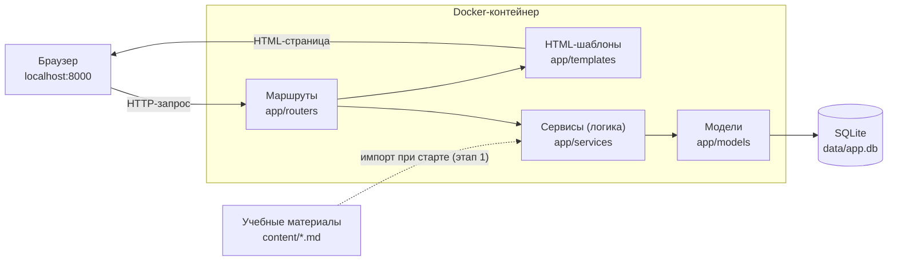

# Учебная платформа

Персональное веб-приложение для самообучения по треку
«с нуля → junior AI-разработчик (LLM-приложения на Python)».
Запускается на своём компьютере одной командой и после сборки работает без интернета.

**Состояние: этап 0 из 7 — каркас.** Сервер, база данных, Docker и тесты готовы.
Дорожная карта, квизы, планировщик и остальные разделы появятся на следующих этапах.

## Содержание

- [Установка Docker на Windows 11](#установка-docker-на-windows-11)
- [Запуск](#запуск)
- [Команды](#команды)
- [Перенос на другой компьютер](#перенос-на-другой-компьютер)
- [Архитектура](#архитектура)
- [Структура проекта](#структура-проекта)
- [Если что-то не работает](#если-что-то-не-работает)

## Установка Docker на Windows 11

Docker запускает приложение в «контейнере» — изолированной коробке, внутри которой
уже есть Python и все библиотеки. На свой компьютер их ставить не нужно.

Docker на Windows работает через WSL 2 — встроенный в Windows Linux. Заодно у тебя
появится настоящий терминал Ubuntu: это пригодится для учёбы.

### Шаг 1. Проверь, что включена виртуализация

Нажми `Ctrl+Shift+Esc` → вкладка **Производительность** → **ЦП**.
Справа внизу должно быть написано **Виртуализация: Включено**.
Если «Отключено» — её нужно включить в BIOS компьютера (ищи пункт Intel VT-x, AMD-V или SVM Mode).

### Шаг 2. Установи WSL 2 и Ubuntu

Открой меню «Пуск», набери `PowerShell`, нажми правой кнопкой →
**Запуск от имени администратора**. Выполни:

```powershell
wsl --install
```

Перезагрузи компьютер. После перезагрузки откроется окно Ubuntu и попросит придумать
имя пользователя и пароль (при вводе пароля символы не отображаются — это нормально).

### Шаг 3. Установи Docker Desktop

1. Скачай установщик: <https://www.docker.com/products/docker-desktop/> (кнопка для Windows).
2. Запусти его. Галочку **Use WSL 2 instead of Hyper-V** оставь включённой.
3. После установки перезагрузи компьютер и запусти **Docker Desktop**.
4. Прими соглашение. Вход в аккаунт можно пропустить.
5. Открой **Settings** (шестерёнка) → **Resources** → **WSL integration** →
   включи переключатель напротив **Ubuntu** → **Apply & restart**.

### Шаг 4. Проверь установку

Открой **Ubuntu** из меню «Пуск». Дальше все команды выполняются в этом окне.

```bash
docker --version
```

```bash
docker run hello-world
```

Если вторая команда напечатала `Hello from Docker!` — всё готово.

### Шаг 5. Поставь git и make

```bash
sudo apt update && sudo apt install -y git make
```

## Запуск

Все команды — в терминале Ubuntu. Docker Desktop при этом должен быть запущен.

Скачай проект (один раз):

```bash
mkdir -p ~/projects && cd ~/projects
```

```bash
git clone -b develop https://github.com/whyamone/learning-platform.git
```

```bash
cd learning-platform
```

Запусти:

```bash
docker compose up
```

Первый запуск занимает несколько минут: Docker скачивает Python и библиотеки.
Дальше интернет не нужен. Когда в терминале появится строка
`Uvicorn running on http://0.0.0.0:8000`, открой в браузере:

<http://localhost:8000>

Остановить приложение: `Ctrl+C` в том же окне терминала.

> Папка проекта видна и из Проводника Windows: введи в адресной строке
> `\\wsl$\Ubuntu\home\ИМЯ_ПОЛЬЗОВАТЕЛЯ\projects\learning-platform`.

## Команды

Короткие команды описаны в файле `Makefile`. Полный список: `make help`.

| Команда | Что делает |
|---|---|
| `make up` | Собрать и запустить (остановка — `Ctrl+C`) |
| `make up-d` | Запустить в фоне |
| `make down` | Остановить |
| `make logs` | Показать логи |
| `make test` | Запустить тесты |
| `make lint` | Проверить стиль кода |
| `make format` | Исправить стиль кода автоматически |
| `make shell` | Открыть терминал внутри контейнера |
| `make migrate` | Применить миграции базы данных |
| `make migration name=add_topics` | Создать новую миграцию (имя — латиницей) |

## Перенос на другой компьютер

Весь твой прогресс хранится в одном файле — `data/app.db`.
Код и учебные материалы лежат в git. Поэтому перенос выглядит так:

1. На новом компьютере установи Docker и скачай проект (разделы выше).
2. На старом останови приложение: `make down`.
3. Скопируй файл `data/app.db` со старого компьютера в папку `data/` на новом (флешкой или как удобно).
4. Запусти: `docker compose up`.

Ограничение: автоматической синхронизации нет. Если заниматься на двух компьютерах
по очереди, файл `data/app.db` нужно каждый раз переносить вручную.

## Архитектура



Как читать схему: браузер отправляет запрос → **маршрут** решает, какая функция
отвечает → **сервис** выполняет логику и через **модели** читает или пишет базу →
**шаблон** превращает результат в HTML-страницу.

Почему сделано именно так — простым языком в [docs/decisions.md](docs/decisions.md).

## Структура проекта

```
learning-platform/
├── app/                  # код приложения
│   ├── main.py           # точка входа: создаёт FastAPI-приложение
│   ├── config.py         # настройки (читаются из .env)
│   ├── db.py             # подключение к базе данных
│   ├── templating.py     # настройка HTML-шаблонов
│   ├── models/           # таблицы базы в виде Python-классов
│   ├── routers/          # маршруты: какой адрес — какая функция
│   ├── services/         # логика, не зависящая от веба
│   ├── templates/        # HTML-шаблоны (Jinja2)
│   └── static/           # стили и скрипты (всё локально, без CDN)
├── migrations/           # история изменений структуры базы (Alembic)
├── tests/                # тесты (pytest)
├── content/              # учебные материалы (появятся на этапе 1)
├── data/                 # файл базы данных (в git не попадает)
├── docs/decisions.md     # объяснение ключевых решений
├── Dockerfile            # как собрать образ
├── docker-compose.yml    # как запустить контейнер
├── Makefile              # короткие команды
├── requirements.txt      # библиотеки приложения
├── requirements-dev.txt  # библиотеки для тестов и линтера
└── pyproject.toml        # настройки ruff и pytest
```

## Если что-то не работает

| Что видишь | Что сделать |
|---|---|
| `Cannot connect to the Docker daemon` | Запусти Docker Desktop и дождись, пока значок перестанет мигать |
| `docker: command not found` в Ubuntu | Docker Desktop → Settings → Resources → WSL integration → включи Ubuntu |
| `port is already allocated` | Порт 8000 занят: выполни `make down` или закрой программу, которая его использует |
| `make: command not found` | Выполни шаг 5 установки |
| Страница не открывается | Открой <http://localhost:8000/health> — там видно состояние приложения; посмотри `make logs` |
| Ошибка при скачивании образа `python:3.12-slim` | Нет доступа к Docker Hub: проверь интернет и повтори `docker compose up` |
