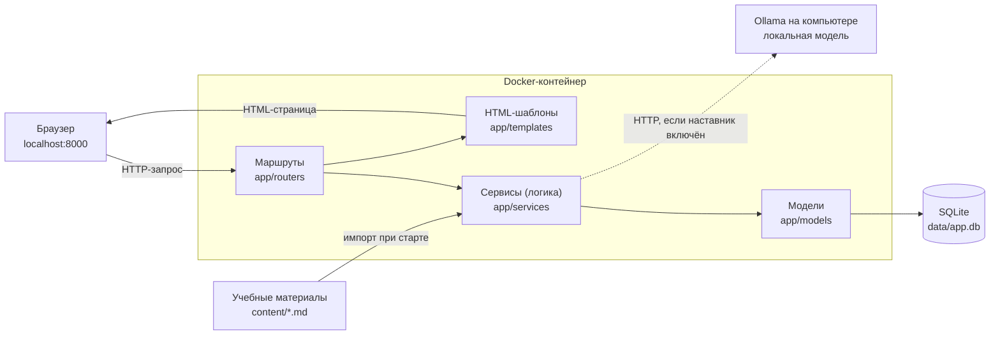

# Учебная платформа

Персональное веб-приложение для самообучения по треку
«с нуля → junior AI-разработчик (LLM-приложения на Python)».
Запускается на своём компьютере одной командой и после сборки работает без интернета.

**Состояние: этап 6 из 7 — ИИ-наставник.** Работают дорожная карта, квизы, карточки
с интервальным повторением, таймер занятий, журнал, дашборд с прогнозом, план недели
и чат с локальной языковой моделью на странице темы (включается отдельно).
Написаны 94 темы, 339 вопросов и 339 карточек.

## Содержание

- [Установка Docker на Windows 11](#установка-docker-на-windows-11)
- [Запуск](#запуск)
- [Обновление](#обновление)
- [Что внутри](#что-внутри)
- [Как добавить тему](#как-добавить-тему)
- [Квизы и карточки](#квизы-и-карточки)
- [Время, журнал и дашборд](#время-журнал-и-дашборд)
- [План недели](#план-недели)
- [ИИ-наставник](#ии-наставник)
- [Настройки](#настройки)
- [Команды](#команды)
- [Перенос на другой компьютер](#перенос-на-другой-компьютер)
- [Архитектура](#архитектура)
- [Структура проекта](#структура-проекта)
- [Если что-то не работает](#если-что-то-не-работает)

## Установка Docker на Windows 11

Docker запускает приложение в «контейнере» — изолированной коробке, внутри которой
уже есть Python и все библиотеки. На свой компьютер их ставить не нужно.

Docker на Windows работает через WSL 2 — встроенный в Windows Linux. Заодно у тебя
появится настоящий терминал Ubuntu: это пригодится для учёбы.

### Шаг 1. Проверь, что включена виртуализация

Нажми `Ctrl+Shift+Esc` → вкладка **Производительность** → **ЦП**.
Справа внизу должно быть написано **Виртуализация: Включено**.
Если «Отключено» — её нужно включить в BIOS компьютера (ищи пункт Intel VT-x, AMD-V или SVM Mode).

### Шаг 2. Установи WSL 2 и Ubuntu

Открой меню «Пуск», набери `PowerShell`, нажми правой кнопкой →
**Запуск от имени администратора**. Выполни:

```powershell
wsl --install
```

Перезагрузи компьютер. После перезагрузки откроется окно Ubuntu и попросит придумать
имя пользователя и пароль (при вводе пароля символы не отображаются — это нормально).

### Шаг 3. Установи Docker Desktop

1. Скачай установщик: <https://www.docker.com/products/docker-desktop/> (кнопка для Windows).
2. Запусти его. Галочку **Use WSL 2 instead of Hyper-V** оставь включённой.
3. После установки перезагрузи компьютер и запусти **Docker Desktop**.
4. Прими соглашение. Вход в аккаунт можно пропустить.
5. Открой **Settings** (шестерёнка) → **Resources** → **WSL integration** →
   включи переключатель напротив **Ubuntu** → **Apply & restart**.

### Шаг 4. Проверь установку

Открой **Ubuntu** из меню «Пуск». Дальше все команды выполняются в этом окне.

```bash
docker --version
```

```bash
docker run hello-world
```

Если вторая команда напечатала `Hello from Docker!` — всё готово.

### Шаг 5. Поставь git и make

```bash
sudo apt update && sudo apt install -y git make
```

## Запуск

Все команды — в терминале Ubuntu. Docker Desktop при этом должен быть запущен.

Скачай проект (один раз):

```bash
mkdir -p ~/projects && cd ~/projects
```

```bash
git clone https://github.com/whyamone/learning-platform.git
```

```bash
cd learning-platform
```

Запусти:

```bash
docker compose up
```

Первый запуск занимает несколько минут: Docker скачивает Python и библиотеки.
Дальше интернет не нужен. Когда в терминале появится строка
`Uvicorn running on http://0.0.0.0:8000`, открой в браузере:

<http://localhost:8000>

Остановить приложение: `Ctrl+C` в том же окне терминала.

> Папка проекта видна и из Проводника Windows: введи в адресной строке
> `\\wsl$\Ubuntu\home\ИМЯ_ПОЛЬЗОВАТЕЛЯ\projects\learning-platform`.

## Обновление

Когда в репозитории появилась новая версия, скачивать проект заново не нужно.
Достаточно четырёх команд в терминале Ubuntu:

```bash
cd ~/projects/learning-platform
```

```bash
docker compose down
```

```bash
git pull
```

```bash
docker compose up --build
```

| Команда | Что делает |
|---|---|
| `cd ...` | Переходит в папку проекта. Команды `docker compose` и `git` работают только из неё |
| `docker compose down` | Останавливает запущенную старую версию |
| `git pull` | Скачивает с GitHub изменения (`git clone` нужен только для первого скачивания) |
| `docker compose up --build` | Пересобирает образ с новым кодом и запускает. Без `--build` запустится старая сборка |

Прогресс при обновлении сохраняется: он лежит в файле `data/app.db`, который git не трогает.

## Что внутри

Дорожная карта рассчитана на 20 месяцев при 11–12 часах занятий в неделю.

| Этап | Месяцы | Модули | Тем | Часов |
|---|---|---|---|---|
| 1. Фундамент | 1–4 | Python: основы · Linux · Git · итоговый проект | 32 | 157 |
| 2. Инструменты | 5–8 | Python глубже · HTTP и веб-API · SQL · Docker · Telegram-бот | 23 | 153 |
| 3. AI-разработка | 9–14 | LLM и промптинг · эмбеддинги · RAG · агенты · оценка качества | 21 | 219 |
| 4. Усиление и поиск работы | 15–20 | Основы ML · локальный инференс · CI/CD и деплой · поиск работы | 18 | 164 |

Всего 94 темы и около 690 учебных часов. За 20 месяцев в таком режиме набирается
около 1000 часов — остаток отведён на повторение, квизы и неизбежные пропуски.

Насколько подробно написаны темы:

- **Python и Linux (26 тем)** — полная теория с примерами, практика из 5–8 заданий.
- **Git и итоговый проект (6 тем)** — краткая теория и практика.
- **Этапы 2–4 (62 темы)** — заготовки: цель, ключевые понятия, словарик, практическое
  задание, критерий «готово» и ссылки. На карте они помечены словом «заготовка».
  Подробную теорию можно дописать самому — это хороший способ закрепить материал.

К каждой теме есть квиз (3–5 вопросов с объяснениями) и карточки для повторения.

В каждой теме есть словарик английских терминов. Основные материалы подобраны
на русском, официальная документация на английском идёт как дополнительная.

Ссылки на внешние сайты со временем устаревают. Проверить их все разом: `make check-links`.

## Как добавить тему

Учебные материалы — обычные текстовые файлы в папке `content/`. Код править не нужно.

### Как устроена папка

```
content/
└── 01-fundament/                    ← этап
    ├── stage.yaml                   ← название и описание этапа
    └── 01-python-osnovy/            ← модуль
        ├── module.yaml              ← название и описание модуля
        └── 01-pervaya-programma.md  ← тема
```

Правило имён: **номер, дефис, слова латиницей в нижнем регистре** — `02-peremennye.md`.
Номер задаёт порядок на карте. Часть после номера становится адресом темы
(`/topics/peremennye`), поэтому у двух тем она не должна совпадать.

### Шаг 1. Создай файл темы

В папке нужного модуля создай файл, например `content/01-fundament/01-python-osnovy/02-peremennye.md`:

````markdown
---
title: Переменные и типы данных
summary: Одна-две строки о том, что это за тема.
goal: Чему я научусь.
estimated_hours: 2.5
concepts:
  - переменная
  - тип данных
glossary:
  variable: переменная
  integer: целое число
links:
  - title: Название материала
    url: https://example.com/
    kind: article
    lang: ru
done_criteria:
  - Могу объяснить, что такое переменная
---

# Теория

Обычный текст в формате Markdown: **жирный**, списки, таблицы.

```python
answer = 42
```

# Практика

Текст задания.
````

Что есть что:

- Между двумя строками `---` находится «шапка» — поля темы в формате YAML.
  Обязательное поле одно: `title`. Отступы делаются пробелами, не табуляцией.
- Всё, что ниже шапки, — текст темы. Заголовок `# Практика` отделяет задание от теории.
- `kind` у ссылки: `docs` (документация), `article` (статья), `course` (курс),
  `video` (видео), `book` (книга), `practice` (тренажёр). `lang`: `ru` или `en`.
- `stub: true` помечает тему как заготовку — подробная теория ещё не написана.

### Шаг 2. Перечитай материалы

Открой страницу «Дорожная карта» и нажми **Перечитать материалы**
(или просто перезапусти приложение — при старте оно читает папку само).

Если в файле ошибка, тема не пропадёт молча: вверху карты появится блок
«Замечания к материалам» с именем файла и описанием проблемы.

### Что происходит с прогрессом

Статусы хранятся отдельно от текста, поэтому правка файла их не сбрасывает.
Если удалить файл темы, она скроется с карты, но её статус останется в базе —
вернёшь файл, вернётся и статус. Если переименовать файл (изменить часть после номера),
приложение сочтёт это новой темой.

### Новый модуль или этап

Создай папку по тому же правилу имён и положи в неё `module.yaml` (или `stage.yaml`):

```yaml
title: Название модуля
description: Короткое описание.
```

Для этапа дополнительно указываются месяцы: `month_from: 5` и `month_to: 8`.

## Квизы и карточки

### Как этим пользоваться

**Квиз** открывается кнопкой «Пройти квиз» на странице темы. После отправки
показывается разбор: где ошибся, какой ответ верный и почему. Квиз считается
пройденным при 80% верных ответов. Попытки не ограничены.

**Карточки** живут в разделе «Повторение». Порядок работы:

1. Читаешь вопрос и вспоминаешь ответ — про себя или вслух.
2. Нажимаешь «Показать ответ».
3. Честно оцениваешь себя одной из четырёх кнопок.

| Кнопка | Когда нажимать | Что будет |
|---|---|---|
| Не помню | Не вспомнил или ошибся | Карточка вернётся завтра, её прогресс сбросится |
| С трудом | Вспомнил, но с усилием | Интервал вырастет, но следующие будут расти медленнее |
| Хорошо | Вспомнил уверенно | Обычный рост интервала: 1 день → 6 дней → 15 → 38… |
| Легко | Вспомнил мгновенно | Интервалы будут расти быстрее |

Под каждой кнопкой написано, когда карточка вернётся.

Карточки темы попадают в очередь, когда ты переводишь тему в статус «В процессе».
Новых карточек в день показывается не больше десяти — число меняется в настройках.

### Как добавить вопросы

Рядом с файлом темы создай файл с тем же именем и окончанием `.quiz.yaml`.
Для темы `02-peremennye.md` это будет `02-peremennye.quiz.yaml`:

```yaml
- question: Чему равно 7 // 2?
  options:
    - "3"
    - "3.5"
    - "4"
  answer: 1
  explanation: Оператор // отбрасывает дробную часть.

- question: Каким знаком присваивают значение?
  options:
    - "=="
    - "="
  answer: 2
```

- `options` — от двух до шести вариантов.
- `answer` — номер правильного варианта, считая с единицы.
- `explanation` — необязательное объяснение, показывается после ответа.

> Варианты, похожие на числа или на слова `yes`, `no`, `true`, `false`, бери
> в кавычки. Иначе YAML прочитает их не как текст.

### Как добавить карточки

Файл с окончанием `.cards.yaml` рядом с темой:

```yaml
- front: Что делает оператор //?
  back: Делит и **отбрасывает** дробную часть.

- front: Чем = отличается от ==?
  back: Первый присваивает, второй сравнивает.
```

`front` — вопрос, `back` — ответ. В обоих полях работает Markdown.

Расписание повторений привязано к тексту вопроса. Ответ (`back`) можно править
свободно — расписание сохранится. Если изменить вопрос (`front`), карточка
будет считаться новой.

После правки нажми «Перечитать материалы» на странице дорожной карты.

## Время, журнал и дашборд

**Таймер.** На странице темы нажми «Начать занятие». Под шапкой сайта появится
строка «Идёт занятие» — она видна на всех страницах. В конце нажми «Закончить».
Время запишется на эту тему.

- Забыл включить таймер — добавь время вручную на странице «Время».
- Забыл выключить — засчитается не больше пяти часов, а лишнее можно исправить
  в таблице на той же странице.
- Занятие короче минуты считается случайным нажатием и не записывается.

**Журнал.** Внизу страницы темы есть блок «Мой журнал»: заметка, ссылка
на репозиторий или на решённую задачу. В заметках работает Markdown.
Все записи собраны на странице «Журнал».

**Дашборд** (главная страница) показывает:

| Что | Как считается |
|---|---|
| Эта неделя | Минуты занятий с понедельника по воскресенье против суммы часов в расписании |
| Серия | Сколько дней подряд были занятия или повторение карточек. Не обрывается, пока день не закончился |
| Темп | Среднее число часов в неделю за последние четыре недели |
| Прогноз | Оставшиеся часы этапа, делённые на темп. В первые две недели берётся плановый темп |

Прогноз пересчитывается при каждом открытии страницы. Пропущенная неделя
не «ломает» план — дата просто сдвигается.

## План недели

Страница «План» раскладывает темы по дням на две недели вперёд.

**Расписание** задаётся внизу той же страницы: сколько часов ты готов заниматься
в каждый день недели. По умолчанию — Пн, Ср, Чт по 2 часа, Сб 3,5 часа, Вс 2 часа,
всего 11,5 часа в неделю. Ноль означает день без занятий.

**Как строится план:**

1. В каждый учебный день первые 10 минут отводятся на карточки.
2. Затем идут темы с пометкой «Повторить» — по 30 минут, чтобы освежить.
3. Затем начатые темы, затем новые — в порядке дорожной карты.
4. Длинная тема делится на несколько дней. Сколько времени ей осталось,
   считается так: оценка в часах минус то, что уже записал таймер.

**Если занятие пропущено,** ничего делать не нужно. План нигде не хранится —
он строится заново при каждом открытии страницы от сегодняшнего дня.
Непройденные темы просто оказываются на ближайших учебных днях.
Прошедшие дни показывают только то, что было на самом деле.

План на сегодня виден и на дашборде.

## ИИ-наставник

Чат на странице темы с языковой моделью, которая работает на твоём компьютере
через Ollama. Модель получает материалы открытой темы и отвечает в одном из трёх режимов:

| Режим | Что делает |
|---|---|
| Объясни проще | Объясняет непонятное простыми словами, с аналогией и примером |
| Проверь моё решение | Разбирает присланный код: что хорошо, где ошибки, с подсказкой вместо готового ответа |
| Спроси меня как на собеседовании | Задаёт вопросы по теме по одному и оценивает ответы |

По умолчанию наставник выключен, и приложение полностью работает без него.
Данные никуда не отправляются: модель работает локально.

### Шаг 1. Установи Ollama

Скачай установщик для Windows с <https://ollama.com/download> и запусти его.
После установки Ollama работает в фоне — её значок появляется возле часов.

### Шаг 2. Скачай модель

Открой PowerShell и выполни:

```powershell
ollama pull qwen2.5:7b
```

Модель занимает около 5 ГБ и помещается в видеокарту с 8 ГБ памяти. Проверь, что она отвечает:

```powershell
ollama run qwen2.5:7b "Привет! Ответь одним предложением."
```

### Шаг 3. Включи наставника

В терминале Ubuntu, в папке проекта:

```bash
cp -n .env.example .env
```

```bash
nano .env
```

Замени строку `AI_MENTOR_ENABLED=false` на `AI_MENTOR_ENABLED=true`, сохрани
(`Ctrl+O`, `Enter`, `Ctrl+X`) и перезапусти приложение:

```bash
docker compose down
```

```bash
docker compose up
```

На странице любой темы появится блок «ИИ-наставник».

### Полезно знать

- Первый ответ после запуска приходит дольше: модель загружается в видеопамять.
- Другую модель можно выбрать строкой `OLLAMA_MODEL=` в `.env`. Сначала скачай её через `ollama pull`.
- Модель видит ограниченный объём текста, поэтому получает сокращённую теорию
  и восемь последних реплик разговора. Длинный разговор лучше начать заново кнопкой под чатом.
- Модель может ошибаться и выдумывать. Проверяй её ответы по теории и документации.

### Если наставник не отвечает

| Сообщение | Что сделать |
|---|---|
| «Не удалось подключиться к серверу модели» | Проверь, что Ollama запущена: открой в браузере <http://localhost:11434> — должно быть написано `Ollama is running` |
| То же, хотя Ollama запущена | Разреши Ollama принимать подключения не только с этого компьютера: в Windows добавь переменную среды `OLLAMA_HOST` со значением `0.0.0.0` и перезапусти Ollama |
| «Модель не найдена» | Скачай её: `ollama pull имя-модели`. Имя должно совпадать с `OLLAMA_MODEL` |
| «Модель не ответила за отведённое время» | Повтори запрос. Если повторяется — возьми модель поменьше или увеличь `OLLAMA_TIMEOUT_SECONDS` |

## Настройки

Настройки задаются в файле `.env` в папке проекта. Чтобы его создать:

```bash
cp .env.example .env
```

| Переменная | По умолчанию | Что означает |
|---|---|---|
| `APP_NAME` | Учебная платформа | Название в шапке сайта |
| `TIMEZONE` | Europe/Moscow | Часовой пояс: по нему определяется, какой сегодня день |
| `NEW_CARDS_PER_DAY` | 10 | Сколько новых карточек показывать в день |
| `AI_MENTOR_ENABLED` | false | Включить ИИ-наставника |
| `OLLAMA_BASE_URL` | http://host.docker.internal:11434/v1 | Адрес сервера модели |
| `OLLAMA_MODEL` | qwen2.5:7b | Имя модели в Ollama |
| `OLLAMA_TIMEOUT_SECONDS` | 180 | Сколько секунд ждать ответа модели |

Если ты живёшь не по московскому времени, укажи свой пояс, например
`TIMEZONE=Asia/Krasnoyarsk` или `TIMEZONE=Asia/Yekaterinburg`. Иначе «сегодня»
в приложении будет сменяться не в полночь, а со сдвигом.

После изменения `.env` перезапусти приложение: `docker compose down`, затем `docker compose up`.

## Команды

Короткие команды описаны в файле `Makefile`. Полный список: `make help`.

| Команда | Что делает |
|---|---|
| `make up` | Собрать и запустить (остановка — `Ctrl+C`) |
| `make up-d` | Запустить в фоне |
| `make down` | Остановить |
| `make logs` | Показать логи |
| `make test` | Запустить тесты |
| `make lint` | Проверить стиль кода |
| `make format` | Исправить стиль кода автоматически |
| `make shell` | Открыть терминал внутри контейнера |
| `make migrate` | Применить миграции базы данных |
| `make migration name=add_topics` | Создать новую миграцию (имя — латиницей) |
| `make check-links` | Проверить, что ссылки в материалах открываются (нужен интернет) |

## Перенос на другой компьютер

Весь твой прогресс хранится в одном файле — `data/app.db`.
Код и учебные материалы лежат в git. Поэтому перенос выглядит так:

1. На новом компьютере установи Docker и скачай проект (разделы выше).
2. На старом останови приложение: `make down`.
3. Скопируй файл `data/app.db` со старого компьютера в папку `data/` на новом (флешкой или как удобно).
4. Запусти: `docker compose up`.

Ограничение: автоматической синхронизации нет. Если заниматься на двух компьютерах
по очереди, файл `data/app.db` нужно каждый раз переносить вручную.

## Архитектура



Как читать схему: браузер отправляет запрос → **маршрут** решает, какая функция
отвечает → **сервис** выполняет логику и через **модели** читает или пишет базу →
**шаблон** превращает результат в HTML-страницу.

Почему сделано именно так — простым языком в [docs/decisions.md](docs/decisions.md).

## Структура проекта

```
learning-platform/
├── app/                  # код приложения
│   ├── main.py           # точка входа: создаёт FastAPI-приложение
│   ├── config.py         # настройки (читаются из .env)
│   ├── db.py             # подключение к базе данных
│   ├── templating.py     # настройка HTML-шаблонов
│   ├── timeutils.py      # работа со временем
│   ├── models/           # таблицы базы в виде Python-классов
│   │   ├── roadmap.py    #   этапы, модули, темы, ссылки
│   │   ├── progress.py   #   статусы тем
│   │   ├── quiz.py       #   вопросы квизов и попытки
│   │   ├── card.py       #   карточки, расписание повторений, журнал ответов
│   │   ├── activity.py   #   занятия (учёт времени) и записи журнала
│   │   └── setting.py    #   настройки пользователя
│   ├── routers/          # маршруты: какой адрес — какая функция
│   ├── services/         # логика, не зависящая от веба
│   │   ├── content_loader.py  # чтение файлов из content/
│   │   ├── importer.py        # запись прочитанного в базу
│   │   ├── roadmap.py         # прогресс, статусы, соседние темы
│   │   ├── quiz.py            # проверка ответов квиза
│   │   ├── sm2.py             # алгоритм интервального повторения
│   │   ├── cards.py           # очередь «повторить сегодня»
│   │   ├── study.py           # таймер и ручной ввод времени
│   │   ├── journal.py         # заметки и ссылки к темам
│   │   ├── dashboard.py       # неделя, серия дней, темп, прогноз
│   │   ├── schedule.py        # расписание занятий по дням недели
│   │   ├── planner.py         # раскладка тем и повторений по дням
│   │   ├── mentor.py          # запросы к языковой модели и история чата
│   │   └── markdown.py        # Markdown → HTML с подсветкой кода
│   ├── tools/            # программы для терминала (проверка ссылок)
│   ├── templates/        # HTML-шаблоны (Jinja2)
│   └── static/           # стили и скрипты (всё локально, без CDN)
├── migrations/           # история изменений структуры базы (Alembic)
├── tests/                # тесты (pytest)
├── content/              # учебные материалы: темы, квизы, карточки (Markdown + YAML)
├── data/                 # файл базы данных (в git не попадает)
├── docs/decisions.md     # объяснение ключевых решений
├── Dockerfile            # как собрать образ
├── docker-compose.yml    # как запустить контейнер
├── Makefile              # короткие команды
├── requirements.txt      # библиотеки приложения
├── requirements-dev.txt  # библиотеки для тестов и линтера
└── pyproject.toml        # настройки ruff и pytest
```

## Если что-то не работает

| Что видишь | Что сделать |
|---|---|
| `Cannot connect to the Docker daemon` | Запусти Docker Desktop и дождись, пока значок перестанет мигать |
| `docker: command not found` в Ubuntu | Docker Desktop → Settings → Resources → WSL integration → включи Ubuntu |
| `no configuration file provided: not found` | Команда запущена не из папки проекта: сначала выполни `cd ~/projects/learning-platform` |
| `fatal: destination path ... already exists` при `git clone` | Проект уже скачан. Чтобы получить новую версию, см. раздел «Обновление» |
| После `git pull` на сайте ничего не изменилось | Запусти с пересборкой: `docker compose up --build` |
| `port is already allocated` | Порт 8000 занят: выполни `make down` или закрой программу, которая его использует |
| `make: command not found` | Выполни шаг 5 установки |
| На карте блок «Замечания к материалам» | В файле из `content/` ошибка: в блоке указаны имя файла и причина. Исправь файл и нажми «Перечитать материалы» |
| Страница не открывается | Открой <http://localhost:8000/health> — там видно состояние приложения; посмотри `make logs` |
| Ошибка при скачивании образа `python:3.12-slim` | Нет доступа к Docker Hub: проверь интернет и повтори `docker compose up` |
